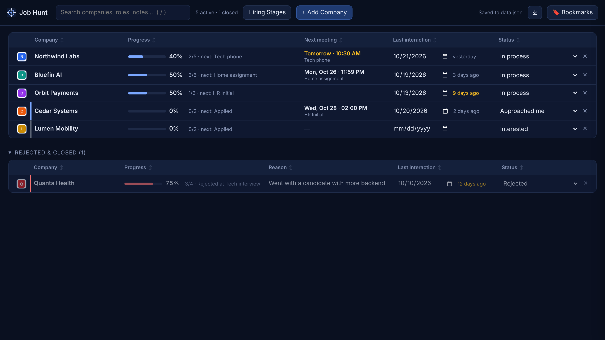
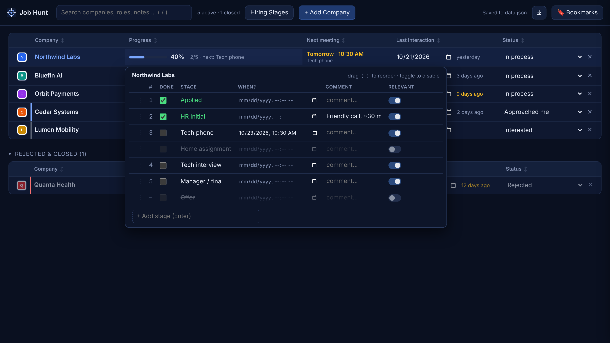
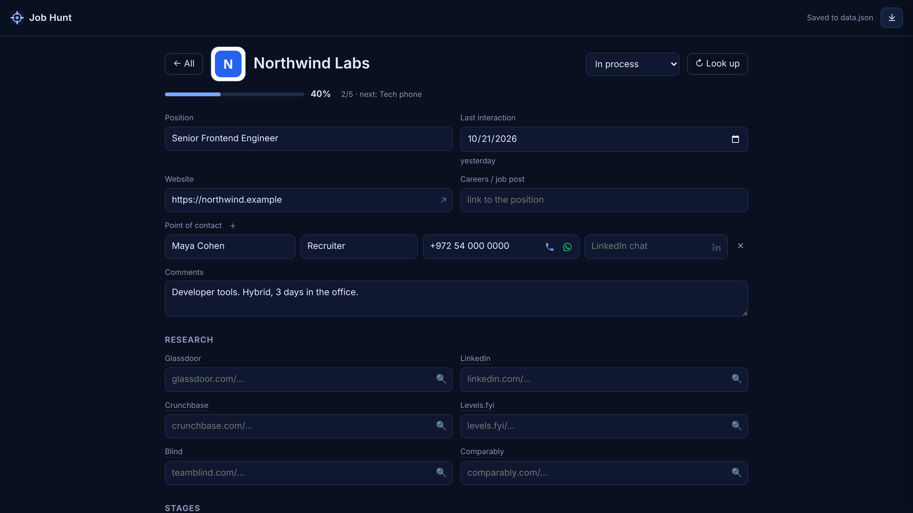
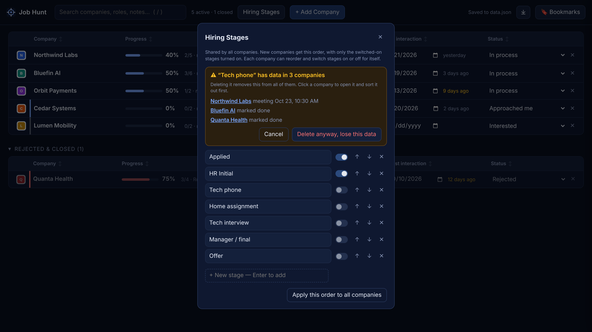
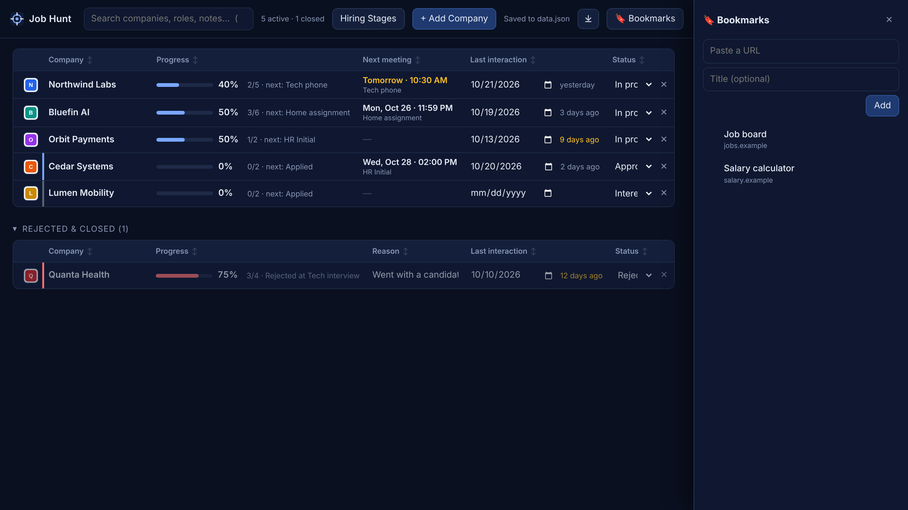

# Job Hunt

A local, spreadsheet-like tracker for job applications and interviews. It lives in a browser tab, saves every edit
to a JSON file on your own machine, and has **zero dependencies**: no accounts, no cloud, no `npm install`, no build
step.



## Features

- **A sheet you edit as you go.** One row per company: progress, next meeting, last interaction and status. Every
  change autosaves.
- **Hiring stages that match reality.** A shared stage list (Applied, HR, Tech phone, Home assignment…) that each
  company can reorder or switch off. Hover the Progress bar to tick stages, set a meeting ("when?"), add comments,
  drag to reorder, or add a stage on the spot.
- **What's next at a glance.** The Next meeting column shows the earliest upcoming meeting (highlighted for today
  and tomorrow), and Last interaction turns amber after a week of silence. Ticking a stage counts as an interaction.
- **Closed processes out of the way.** Rejected and withdrawn companies move to their own collapsible table, with
  a Reason column.
- **Add a company by name.** A naive lookup fills in the website, logo and research links (Glassdoor, LinkedIn,
  Crunchbase, Levels.fyi, Blind, Comparably…), mostly from Wikidata. Anything it can't find gets a one-click search.
- **A page per company:** points of contact (📞 call and WhatsApp Web links generated from the phone number), six
  research sites with explanations, the stage list, and free-text note sections for interview prep.
- **Safe stage changes.** Deleting a stage that companies have data on lists them first, so you can sort things out
  before deleting.
- **Sort and reorder** any column, **search** across everything (`/`), and a **bookmarks drawer** (`B`) for job
  boards, salary calculators or your CV.
- **Automatic backups** (see below).

| Progress popover | Company page |
|---|---|
|  |  |
| **Stage delete warning** | **Bookmarks drawer** |
|  |  |

## Run it

You need [Node.js](https://nodejs.org) 18 or newer. Nothing else.

```sh
git clone https://github.com/tzookyb/job-hunt.git
cd job-hunt
npm start
```

Then open http://localhost:4317.

- **Try it with sample data first:** `npm run demo` (http://localhost:4318). It uses fictional companies in
  `.demo-data/` and never touches your own data.
- **Another port:** `PORT=5000 npm start`.
- **On a Mac** you can also double-click `start.command` (or right-click → Open With → Terminal / iTerm).

If the top-right corner says **"No server — saving in this browser only"**, the page isn't talking to the server
(it was opened as a file, or the server isn't running). Start it and open http://localhost:4317.

**Why a server?** Browsers don't let a web page write files to your disk. The server's job is to write your data
file, make backups and run the company lookup. Everything else happens in the page.

## Your data

Everything personal lives in **`user-data/`**, kept apart from the app code and ignored by git:

| File | What |
|---|---|
| `user-data/data.json` | Your database, created on your first edit. The server prints its path when it starts. |
| `user-data/data.backup.json` | The previous save. |
| `user-data/backups/` | Automatic backups. |

- **Move your data** to another machine: copy `user-data/`.
- **Share the app** with a friend: they clone the repo and start with an empty tracker.
- **Keep the data elsewhere** (e.g. a synced folder): `DATA_DIR=/path/to/folder npm start`.

## Backups

Three layers, so a bad edit or a mistaken delete is always recoverable:

1. **Every save** first copies the current file to `data.backup.json`, then writes the new version atomically
   (temp file + rename), so a crash mid-write can't corrupt your data.
2. **Automatic backups, driven by use rather than a timer.** Whenever the app talks to the server (opening it,
   saving), it checks, at most once a minute, whether the newest backup in `user-data/backups/` is 6 or more hours
   old. If it is, `data.json` is copied to `auto-<date>.json`. On a save the copy is made *before* writing, so the
   backup holds the last good version.
   - Automatic backups older than **7 days** are deleted.
   - **Nothing happens while you're not using the app**: after a weekend away there are no empty duplicate backups,
     and the first interaction afterwards makes a fresh one.
   - Any other file you put in `backups/` (like a `manual/` folder) is never touched.
3. **⤓ Back up now** in the top bar saves any pending edit, then makes a backup immediately.

To restore, stop the server, copy the backup you want over `user-data/data.json`, and start it again.

## Keys

`/` search · `B` bookmarks · `Esc` closes the popover, drawer or dialog, or leaves the company page.

## How it's built

- **No framework, no bundler.** The page is plain HTML and CSS plus native ES modules; the server uses only Node's
  standard library.
- **Small modules with one job each.** Pure logic in `public/js/model/` (no DOM, no I/O); one file per UI feature in
  `public/js/views/`, each registering its own event listeners, talking to the others through a tiny event bus.
  The server is split the same way (`storage`, `backups`, `routes`, and `lookup/` with an injectable fetcher).
- **Backward-compatible data.** `normalize()` upgrades older data on load, so the schema could change many times
  without ever breaking a saved file.
- **Tested with `npm test`** (Node's built-in test runner): the data model, storage, the API, backups (with an
  injected clock) and the lookup (against a fake network). UI changes were checked in headless Chromium.

### Built spec by spec, with AI

This app was built in a few hours of conversation with Claude, one small spec at a time, while I used it for my
own job search. The history is meant to be read:

- **Every commit message starts with the spec** as I gave it, followed by what was built and what was learned.
- **[`AGENTS.md`](AGENTS.md)** is the project's shared memory for AI agents (`CLAUDE.md` just points to it). Every
  commit updates it: ground rules, architecture, data model, the decisions behind them, what failed and why, and a
  work log. Read it at any commit to see the project through the agent's eyes at that point.

```sh
git log --reverse --format='%n%h %s%n%b' | less
```

## License

[MIT](LICENSE)
